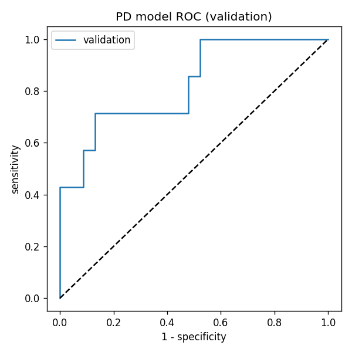

# Credit Risk Modelling for IFRS 9 (SAS and Python)

End-to-end credit risk pipeline that estimates **Probability of Default (PD)**,
**Loss Given Default (LGD)** and **Exposure at Default (EAD)** and combines them
into an **IFRS 9 Expected Credit Loss (ECL)**. The same methodology is implemented
in both SAS and Python.

> **Data note:** all datasets are synthetic (100 rows each) and were created for
> demonstration. No real customer, bank or employer data is used.

## What this project does

1. **Extract and clean** loan data (PROC SQL in SAS, pandas in Python). Oracle and
   Teradata connection code is included as a commented template.
2. **Engineer borrower features:** credit utilisation, debt-to-income ratio,
   account age, delinquency history.
3. **PD model:** logistic regression with stepwise selection, stratified 70/30
   split, AUC / Gini / KS and calibration by risk group.
4. **LGD model:** regression on recovery rates (PROC REG / statsmodels OLS) with a
   5% LGD floor.
5. **EAD:** credit conversion factors (CCF) by product and utilisation band;
   term loans use the outstanding balance.
6. **IFRS 9 staging and ECL:** `ECL = PD x LGD x EAD x discount factor`
   (12-month PD for Stage 1, lifetime PD for Stage 2, 100% for Stage 3).

## Results (Python run on the synthetic data)

| Metric | Value |
|---|---|
| PD model, validation AUC / Gini / KS | 0.83 / 0.65 / 0.58 |
| PD model, training AUC / Gini / KS | 0.88 / 0.75 / 0.62 |
| LGD model R-squared | 0.88 |
| Stage 1 ECL coverage (62 loans) | 4.7% |
| Stage 2 ECL coverage (38 loans) | 28.9% |
| Total EAD / total ECL | about 28.8m / 4.6m |



SAS results will differ slightly from Python because the random split and the
stepwise selection tests are implemented differently.

## Repository structure

```
credit-risk-ifrs9-sas-python/
    README.md
    LICENSE
    requirements.txt
    .gitignore
    data/
        pd_loan_data.csv        loans, borrower features, 12-month default flag
        lgd_data.csv            defaulted loans with recoveries
        ead_data.csv            defaulted revolving facilities
    sas/
        credit_risk_model.sas   full SAS program
    python/
        credit_risk_model.py    full Python port
    docs/
        Credit_Risk_Project_Guide.docx    steps, data dictionary, how to run
        GitHub_Showcase_Guide.docx        how to publish this project
    images/
        pd_roc_curve.png
```

## How to run

### Python
```
pip install -r requirements.txt
python python/credit_risk_model.py
```
Run it from the repository root. Results are written to `output/` and the fitted
models to `models/`.

### SAS
1. Open `sas/credit_risk_model.sas` in SAS Studio, Enterprise Guide or Base SAS
   (SAS OnDemand for Academics works).
2. Set `proj_path` at the top to the repository root folder, the one that
   contains `data/` and `sas/`, not the `.sas` file itself.
3. Run the whole program and check the log for errors. Results are written to
   `output/` and `sasdata/`.

Requires SAS/STAT (PROC LOGISTIC, PROC REG, PROC SURVEYSELECT).

## Limitations

- Small synthetic sample, so results are illustrative only.
- 12-month point-in-time PD; lifetime PD assumes a constant hazard rate.
- No forward-looking macroeconomic scenarios and no formal model validation
  (out-of-time testing, PSI, back-testing).
- LGD uses OLS on bounded recovery rates; production models often use beta
  regression or a two-stage approach plus a downturn adjustment.
- No loans are in Stage 3 because the sample contains only performing loans.

## Skills demonstrated

SAS (PROC SQL, LOGISTIC, REG, MEANS, SURVEYSELECT), Python (pandas, statsmodels,
scikit-learn), IFRS 9 ECL, feature engineering, model discrimination and
calibration metrics, technical documentation.

## Author

Your Name - [LinkedIn](https://www.linkedin.com/in/sunil-kale-2688b2195) - kaless1993@gmail.com

Licensed under the MIT License.
